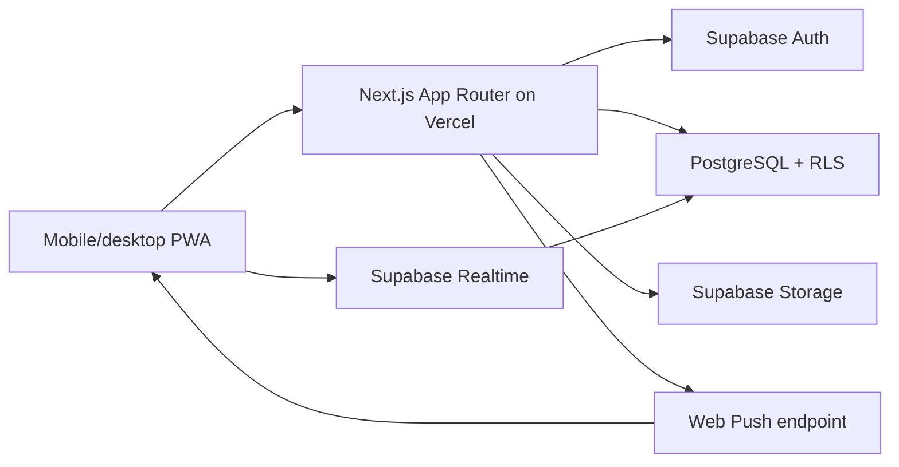
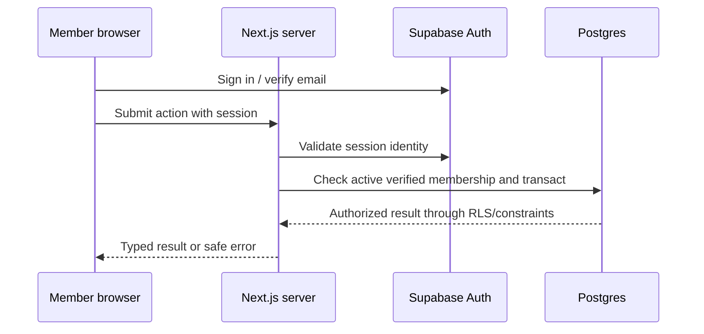

# Architecture

The local Next.js app uses a linked Supabase test project for Auth, PostgreSQL, Realtime, private image Storage, Cron and a push delivery queue. Trip, item, matching, chat, notifications, reporting and moderation workflows have live fictional-account browser coverage. The protected Web Push sender works locally against the queue; hosted scheduling and real-device delivery remain unverified. Vercel has not been deployed. The diagram shows the deployment target.

## Responsibilities and boundaries

React pages/components own presentation and local interaction. Server actions or route handlers validate Zod input, resolve the authenticated user, check workflow eligibility and invoke database operations. Postgres constraints, grants, RLS and narrow transactional functions preserve invariants under concurrent requests. Privileged credentials stay in server-only modules and are reserved for narrowly reviewed jobs/moderation operations. Realtime is a delivery signal; the database is the source of truth and reconnecting clients refetch.

Use bounded queries with explicit campus/status/time filters. Keep email in Supabase Auth, outside public profile rows. Item images use a private bucket with ownership rules and short-lived signed retrieval. The current service worker performs no fetch caching, so authenticated responses are never stored by it.

## Request and identity flows

The email-domain check occurs at signup and again when granting active membership. Email verification alone does not establish allowed-campus status. Authorization derives from trusted user and membership records. Browser Realtime subscriptions receive a session token before subscribing; Postgres RLS limits message events to authorized members.

## Chat and notifications

Messages attach to a workflow conversation. Only the two eligible members can read/send. Inserts use a client-generated idempotency key; authenticated Realtime subscribers refetch on inserts, with a 20-second polling fallback. Unread counts derive from the last-read message ID per participant. In-app notifications are stored in Postgres. Push subscriptions are per device, permission is requested only after a button press, and payloads contain no private message text. The local sender claims pending deliveries through a service-role RPC with bounded retries; it still needs a hosted schedule.

Daily product counts are updated transactionally by database triggers for trip creation/completion, join requests/acceptances and item creation/completion. Rows contain only campus, UTC day, event type and count. Only same-campus moderators can read them. Critical server errors log operation and database error code, without form contents or private message text; a hosted log/alert workflow is still a release task.

Moderators can disable or restore campus location zones through one audited RPC. The database prevents disabling zones in active trip/item workflows and requires active zones when new workflows are created.

## Deployment and scale

One Next.js deployment plus one Supabase project is the target. No permanent worker or separate socket server is planned. The expected 1,000 registered users and up to 100 weekend daily active users are assumptions, not tested capacity. Measure concurrent Realtime connections and database size before rollout. See [costs](COSTS.md) and [deployment](DEPLOYMENT.md). The Vercel Hobby non-commercial eligibility and production email delivery require resolution before public launch.
